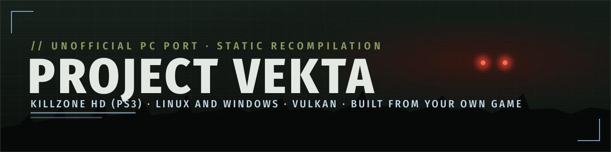

<p align="center">
  
</p>

# Project Vekta (work in progress)

**Killzone HD: unofficial PC port (static recompilation)**


-0078D6)


**[Status](#status)** · **[Features](docs/FEATURES.md)** · **[Screenshots](docs/SCREENSHOTS.md)** ·
**[Requirements](docs/requirements.md)** · **[Getting your files](docs/GETTING-FILES.md)** ·
**[Building](docs/BUILDING.md)** · **[How it works](docs/HOW-IT-WORKS.md)** · **[Known issues](docs/KNOWN_ISSUES.md)** ·
**[Roadmap](docs/ROADMAP.md)** · **[Glossary](docs/GLOSSARY.md)** · **[AI use](#how-ai-was-used)** ·
**[Contributing](.github/CONTRIBUTING.md)** · **[Forking](docs/FORKING.md)**

*Vekta* is the ISA colony world where the first Killzone is fought. Project Vekta is a fan project, not official and
not affiliated with or endorsed by Sony Interactive Entertainment or Guerrilla Games.

**What this is:** a static recompilation of **Killzone HD**, the PS3 remaster of the first Killzone (title NPUA80856,
the package on the Killzone Trilogy disc). The game's PowerPC (PPU) and Cell SPU code is translated to C++ ahead of
time with [ps3recomp](https://github.com/sp00nznet/ps3recomp) (pinned at v0.18.0, plus this project's patches in
`port/patches/`) and compiled into a native Linux or Windows x64 program. It is **not an emulator** (no CPU emulator
runs at play time) and **not a rewrite** (the game's logic is the game's own code). Around that code, the PS3's
system libraries and hardware behaviour are reimplemented on PC APIs, and the game's graphics commands are replayed
on Vulkan.

**You need your own copy of the game.** This repository contains only the port: source code, patches to the
recompiler, tools and documentation. It contains no game code, data, assets, keys or firmware, and it never will.
Each player translates and builds the game's code on their own machine, from their own files.

## Status

As of 2026-10-30, on Linux x64 with an NVIDIA RTX 3070 Ti, the maintainer's machine:

| | |
|---|---|
| Code translation | the whole EBOOT is translated (about 23,400 PPU functions) plus the SPU programs, job modules and the firmware pieces the game loads; this repository's scripts rebuild it byte for byte from the player's files |
| Boot, menus, movies | work: intro movies, front end, options, pause menu, saves and Continue |
| Campaign | Level 1 played by hand from start to end; all 11 levels load and reach gameplay; parts of the campaign played by hand on 2026-10-20; levels 2 to 11 not yet each played to their end |
| Frame rate | a steady 60 frames per second by default (the game logic runs at 60 Hz instead of the PS3's 30); an optional 144 Hz mode reaches about 131 to 134 frames per second in Level 1 and Level 7 |
| Sound | stereo, 5.1 and 7.1 output (the game's own mixer fills the extra channels); music through the firmware's MP3 decoder |
| Windows | the Windows exe is cross-built on Linux and runs under Wine, Proton and on a real Windows; the full campaign on Windows is not checked yet, and speed under Wine and Proton is lower (about 100 frames per second in Level 7) |
| Distribution | source only: you build it yourself. An installer that builds the port on the player's PC is the next big milestone |

What works and what does not, item by item: [docs/FEATURES.md](docs/FEATURES.md). Open problems:
[docs/KNOWN_ISSUES.md](docs/KNOWN_ISSUES.md).

## PC features

All optional, set in a **PC** page inside the game's own Options and Pause menus and kept in `kz1hd_pc.ini`:

- display mode (window, borderless, fullscreen), output resolution, internal resolution scale, V-Sync (on, off,
  adaptive), VRR, frame-rate limit (30, 60, 144), NVIDIA Reflex
- AMD FSR 1 upscaling and RCAS sharpening, anisotropic filtering (the game's own or 2x to 16x)
- widescreen (Hor+ for 21:9, 32:9 and wider, with the menus and movies kept 16:9), field of view, HUD size and position
- presets: Original (PS3), Performance, Balanced, Quality
- keyboard and mouse (direct mouse look, mouse in menus, remappable keys), Xbox, PlayStation, Nintendo and generic
  controllers through SDL, with button prompts that follow the device in use
- stereo, 5.1 or 7.1 sound; game language; skip the opening movie; local trophies from the game's own trophy set

## What goes online

Nothing. The port, its scripts and the build make no network connection of their own. The only downloads are the
ones you start: cloning this repository with its ps3recomp submodule, and your system's packages.

## Where your data goes

Everything stays in the folder the game runs from, `work/vfs/` (made by `tools/setup-vfs.sh`): the PC settings in
`kz1hd_pc.ini`, the key map in `kz1hd_keys.ini`, saves under `gamedata/dev_hdd0/home/00000001/savedata/`, and the
local trophy log in `gamedata/trophies/`. The log of a run goes to `work/play.log`. Nothing is written outside the
repository's `work/` folder, and nothing is written into your game files.

## Getting it

Latest release: <!-- release -->[v0.1.0](https://github.com/gustavomorinaga/project-vekta/releases/tag/v0.1.0), a source pre-release<!-- /release -->. Releases are source archives (this tree with ps3recomp at
its pinned commit, checked by SHA-256); either way the port is built on your machine from your own game
([docs/BUILDING.md](docs/BUILDING.md)). You need:

- the Killzone HD package from your own **Killzone Trilogy** disc, installed, plus its decrypted
  EBOOT and data archive, and the decrypted `libsre` from your own PS3 firmware: what each must be, and how the
  scripts check them, is in [docs/GETTING-FILES.md](docs/GETTING-FILES.md);
- Linux x64 with clang, CMake, Ninja, Python 3, SDL2, zlib, glslang and the Vulkan headers; for the Windows exe, the
  MinGW-w64 sysroot as well;
- a CPU with AVX2 (x86-64-v3) and a Vulkan GPU ([docs/requirements.md](docs/requirements.md)).

The short way, from a release's archive or a clone: one command asks where your files are, checks them, and builds
with one progress bar; it remembers the paths, so afterwards `tools/play.sh` is all you need.

```sh
tools/install.sh
tools/play.sh
```

Step by step (what `tools/install.sh` runs):

```sh
git clone --recurse-submodules https://github.com/gustavomorinaga/project-vekta
cd project-vekta
tools/ps3recomp-patched.sh   # ps3recomp v0.18.0 with port/patches applied, in work/
tools/lift.sh                # translates your EBOOT, SPU code and firmware pieces, in work/lift
tools/setup-vfs.sh           # the folder the game runs from, in work/vfs
tools/build.sh               # work/build/KZ1HD
tools/play.sh                # plays in a window
```

## How it works, briefly

- **PPU:** the game's PowerPC functions are lifted to C++ by ps3recomp's lifter and compiled with clang; a few hot
  functions are reimplemented natively (`port/kz1hd/native_ppu/`).
- **SPU:** the SPU programs and the WWS job modules are lifted the same way; SPURS runs on host threads; some SPU
  jobs run as native C (`port/kz1hd/native/`).
- **Graphics:** the game's RSX command stream is replayed on Vulkan, with PC options (scaling, FSR 1, widescreen)
  applied around it.
- **Data:** the game reads its own archive through its own file system code; movies are decoded with FFmpeg.

More: [docs/HOW-IT-WORKS.md](docs/HOW-IT-WORKS.md). General fixes are offered to ps3recomp upstream.

## How AI was used

This project is developed by one person with AI coding agents (Claude Code). The agents did most of the work of
reading the game's binary and reference material, writing and testing patches, tools and documentation, and running
the builds, with the maintainer setting the goals, playing and checking the game, reviewing what they produced and
deciding what is published. Findings are dated; an `ASSUMPTION:` in the code or the docs is not fact. If you find a
statement here that was not verified, please open an issue.

## Related projects

- [Project Helghast](https://github.com/undecuple/project-helghast) (Killzone 3) and
  [Project Pyrrhus](https://github.com/undecuple/project-pyrrhus) (Killzone 2), by undecuple: the same approach for
  the rest of the trilogy, and the model for this repository's layout. Credits: [NOTICE.md](NOTICE.md).
- [ps3recomp](https://github.com/sp00nznet/ps3recomp), the recompiler this port is built on.

## Official channels

Project Vekta is made by **Gustavo Morinaga**: GitHub [@gustavomorinaga](https://github.com/gustavomorinaga), and
the project site <https://gustavomorinaga.github.io/project-vekta/>. Code and, when there are any, builds come only
from this repository. We never ask anyone to paste a command they were sent into a terminal or PowerShell.
Anyone else offering builds, "fixes" or donations in this project's name is not us.

## Contributing

Tests on other hardware, reports with logs, and fixes are welcome: [CONTRIBUTING.md](.github/CONTRIBUTING.md). The
rules for everyone, people and AI coding agents alike, are in [AGENTS.md](AGENTS.md). Security problems and rights
holders' reports go privately through the Security tab ([SECURITY.md](.github/SECURITY.md)).

## Repository layout

| Path | What it holds |
|---|---|
| `port/kz1hd/` | the program: boot, game clock, window, HLE overrides, the PC menu, native SPU and PPU code |
| `port/patches/` | numbered patches to ps3recomp and `series`, the order they apply in |
| `third_party/ps3recomp/` | the recompiler, a pinned submodule (never edited in place) |
| `tools/` | patch, lift, build, run and check scripts; data and profiling tools |
| `re/` | tables the tools read; numbers only |
| `docs/` | the public documentation; `docs/dev/` holds engineering notes |
| `site/`, `assets/` | the project page and its images |

## Licence

The port is MIT ([LICENSE](LICENSE)); third-party parts and credits are in [NOTICE.md](NOTICE.md). Killzone and
Killzone HD are (c) Sony Interactive Entertainment; nothing of the game is licensed or included here.
