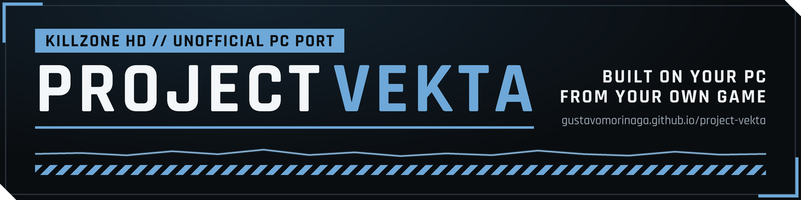

  

<h1 align="center">Project Vekta</h1>

<b>Killzone HD (PS3) as a native Linux and Windows program, built on your PC from your own copy.</b> 
An unofficial fan port by static recompilation. Work in progress, playable from start to end.

  
  
  
  

  
  
  

  
  
  
  
  

  <b><a href="https://github.com/gustavomorinaga/project-vekta/releases">Download</a></b> ·
  <b><a href="docs/INSTALL.md">Installing</a></b> ·
  <b><a href="docs/FAQ.md">FAQ</a></b> ·
  <b><a href="docs/STATUS.md">Status</a></b> ·
  <b><a href="docs/SCREENSHOTS.md">Screenshots</a></b> ·
  <b><a href="https://github.com/gustavomorinaga/project-vekta/issues/new/choose">Report an issue</a></b> ·
  <b><a href="docs/BUILDING.md">Build from source</a></b>

**Project Vekta** is an unofficial fan port of **Killzone HD**, the PS3 remaster of the first Killzone (title
NPUA80856, from the Killzone Trilogy disc or the PlayStation Store), to Linux and Windows x64. The game's own PowerPC
and SPU code is translated to C++ ahead of time with [ps3recomp](https://github.com/sp00nznet/ps3recomp) and compiled
into a native program: it is **not an emulator** and **not a rewrite**. *Vekta* is the ISA colony world where the
first Killzone is fought.

> **Bring your own game.** This repository holds no game code, data, assets, keys or firmware, and downloads none.
> Each player translates and builds the game's code on their own machine, from their own files
> ([what each file must be](docs/GETTING-FILES.md)).

## Status

Latest release: <!-- release -->[v0.7.0](https://github.com/gustavomorinaga/project-vekta/releases/tag/v0.7.0), a pre-release<!-- /release -->. The whole campaign, levels 1 to 11, has been played from start to end on Linux and on
Windows. The levels are not yet each compared with reference footage of the PS3 game.

| | | | |
|---|---|---|---|
| **11 of 11 levels** played from start to end, Linux and Windows (2026-11-16) · [proof](docs/STATUS.md) | **60 fps** steady by default, game logic at 60 Hz (PS3: 30) · [proof](docs/HOW-IT-WORKS.md#frame-rate-above-30) | **0 game files** in the repository or the downloads · [proof](AGENTS.md#rules-for-everyone) | **5 to 30 minutes** for the first build, once · [proof](docs/INSTALL.md) |

One row per setup. *Verified* means the maintainer ran it there; *implemented* means the code is in but not run there.
The full dated table is [docs/STATUS.md](docs/STATUS.md).

| Platform | How it runs | Renderer | State | Tested on |
|---|---|---|---|---|
| Linux x64 | native program | Vulkan | verified: the whole campaign (2026-11-16), 60 fps steady, about 131 to 134 fps in the 144 Hz mode | NVIDIA RTX 3070 Ti, the maintainer's machine |
| Windows x64 | native exe | Vulkan | verified: the whole campaign (2026-11-16) | the maintainer's Windows machine |
| Linux, Windows exe | Wine or Proton | Vulkan | verified, slower (about 100 fps in Level 7) | GE-Proton 11 |

## Download and play

**What you need:**

- **Your own Killzone HD** (NPUA80856, the US edition), installed from your own **Killzone Trilogy** disc or bought on
  the PlayStation Store, or the European edition (NPEA00418) from the PlayStation Store, through your RPCS3. No PS3
  system software is needed ([getting your files](docs/GETTING-FILES.md)).
- **A PC:** Windows or Linux x64, a CPU with AVX2 (x86-64-v3), and a Vulkan graphics card and driver
  ([requirements](docs/requirements.md)).
- **Disk space:** about 4 GB for the game files, plus a few GB free for the port and its build
  ([requirements](docs/requirements.md)).

**Install:**

1. Download from <!-- release -->[v0.7.0](https://github.com/gustavomorinaga/project-vekta/releases/tag/v0.7.0), a pre-release<!-- /release --> on the [releases page](https://github.com/gustavomorinaga/project-vekta/releases): the **setup program**
   (`project-vekta-X.Y.Z-setup.exe`) or the **zip** on Windows, the **folder** (`project-vekta-X.Y.Z-linux.tar.xz`)
   on Linux. Check it against `SHA256SUMS`.
2. Start it: the setup, `Project Vekta.exe` in the zip or `./project-vekta` in the Linux folder. When the game is in
   your RPCS3 it is found and used. With no RPCS3, the copied Killzone Trilogy disc works too (the setup's "From my
   Killzone Trilogy disc", or `--disc FOLDER`: the official RPCS3 is downloaded to install it). Otherwise it asks
   where your files are. You should see your files checked, with anything wrong named.
3. Let it build, once, in 5 to 30 minutes (longer on a hard disk or an older CPU). Nothing of the game is shipped or downloaded, and nothing is written
   into your game files.
4. Play: **Project Vekta** in the Start menu, or the same program again. You should see the intro movies, then the
   menus.

Or through a game launcher, which installs the same folders ([installing through a launcher](docs/INSTALL.md#installing-through-a-launcher)):

Every step, with what you see at each: **[docs/INSTALL.md](docs/INSTALL.md)**.

## What goes online and where your data goes

Nothing, unless you choose it: the port starts no connection of its own. The three you can choose, the NVIDIA DLSS
download, the official RPCS3 for a game straight from the disc and the new-version check (off by default), and where
saves, settings and logs are kept:
[docs/PRIVACY.md](docs/PRIVACY.md).

## PC features

All optional, on a **PC** page in the game's own Options and Pause menus:

- window, borderless or fullscreen, any resolution and aspect ratio (Hor+ up to 32:9), V-Sync, VRR, 30/60/120/144/165/240 fps or
  Unlimited (120 and up experimental),
  NVIDIA Reflex
- AMD FSR 1, AMD FSR 3.1 and NVIDIA DLSS (downloaded only if you accept its licence), anisotropic filtering
- field of view for the world and the weapon, HUD and crosshair size, motion blur, film grain and glow
- keyboard and mouse with direct mouse look, any SDL controller, prompts that follow the device
- stereo, 5.1 or 7.1 sound, game language, local trophies

The full list, with defaults and evidence: [docs/STATUS.md](docs/STATUS.md#pc-features) and
[docs/FEATURES.md](docs/FEATURES.md). Controls and display: [docs/ACCESSIBILITY.md](docs/ACCESSIBILITY.md).

## Known issues

The main ones: the 144 Hz mode is not steady and can shake or ghost the first-person weapon in busy places, and the
levels are not yet each compared with the PS3 game. The full list: [docs/KNOWN_ISSUES.md](docs/KNOWN_ISSUES.md).

## Troubleshooting and reporting bugs

Problems by what you see and by exit code, with the fix and the log to attach:
[docs/TROUBLESHOOTING.md](docs/TROUBLESHOOTING.md). To report a bug,
[open an issue](https://github.com/gustavomorinaga/project-vekta/issues/new/choose).

## Building

From a clone or the release's source archive, `tools/install.sh` asks where your files are, checks them and builds;
then `tools/play.sh` plays. Tools, every step and the Windows build: [docs/BUILDING.md](docs/BUILDING.md).

## How it works

The game's PPU and SPU code is lifted to C++ and compiled with clang; the PS3's system libraries are reimplemented on
PC APIs; the game's RSX command stream is replayed on Vulkan. Details: [docs/HOW-IT-WORKS.md](docs/HOW-IT-WORKS.md).
General fixes are offered to ps3recomp upstream.

## Roadmap

Next: each level compared with the PS3 game, and the rest of the plan in
[docs/ROADMAP.md](docs/ROADMAP.md).

## Contributing

Tests on other hardware, reports with logs, and fixes are welcome: [CONTRIBUTING.md](.github/CONTRIBUTING.md). The
rules for everyone, people and AI coding agents alike, are in [AGENTS.md](AGENTS.md). People who helped:
[CONTRIBUTORS.md](CONTRIBUTORS.md).

## How AI was used

This project is developed by one person with AI coding agents, with the maintainer reviewing and deciding what is
published: [docs/AI.md](docs/AI.md).

## Licence and disclaimer

The port's own code, patches, tools and documentation are MIT ([LICENSE](LICENSE)). Third-party parts and credits:
[NOTICE.md](NOTICE.md). The licence covers nothing of the game. Security problems and rights holders' reports go
privately through the Security tab ([SECURITY.md](.github/SECURITY.md)).

Project Vekta is a fan project, not official and not affiliated with or endorsed by Sony Interactive Entertainment or
Guerrilla Games. Killzone and Killzone HD are (c) Sony Interactive Entertainment; nothing of the game is licensed or
included here.

## Related projects and official channels

- [Project Helghast](https://github.com/undecuple/project-helghast) (Killzone 3) and
  [Project Pyrrhus](https://github.com/undecuple/project-pyrrhus) (Killzone 2), by undecuple: the same approach for
  the rest of the trilogy, and the model for this repository's layout, docs and look. Credits: [NOTICE.md](NOTICE.md).
- [ps3recomp](https://github.com/sp00nznet/ps3recomp), the recompiler this port is built on.

Project Vekta is made by **Gustavo Morinaga**: GitHub [@gustavomorinaga](https://github.com/gustavomorinaga), and
the project site <https://gustavomorinaga.github.io/project-vekta/>. Code and builds come only from this
repository's [releases](https://github.com/gustavomorinaga/project-vekta/releases). We never ask anyone to paste a command they were sent into a terminal or
PowerShell. Anyone else offering builds, "fixes" or donations in this project's name is not us.

More pages: [Features](docs/FEATURES.md) · [Requirements](docs/requirements.md) · [Glossary](docs/GLOSSARY.md) ·
[Forking](docs/FORKING.md) · [Release criteria](docs/RELEASE-CRITERIA.md) · [Changelog](CHANGELOG.md)
