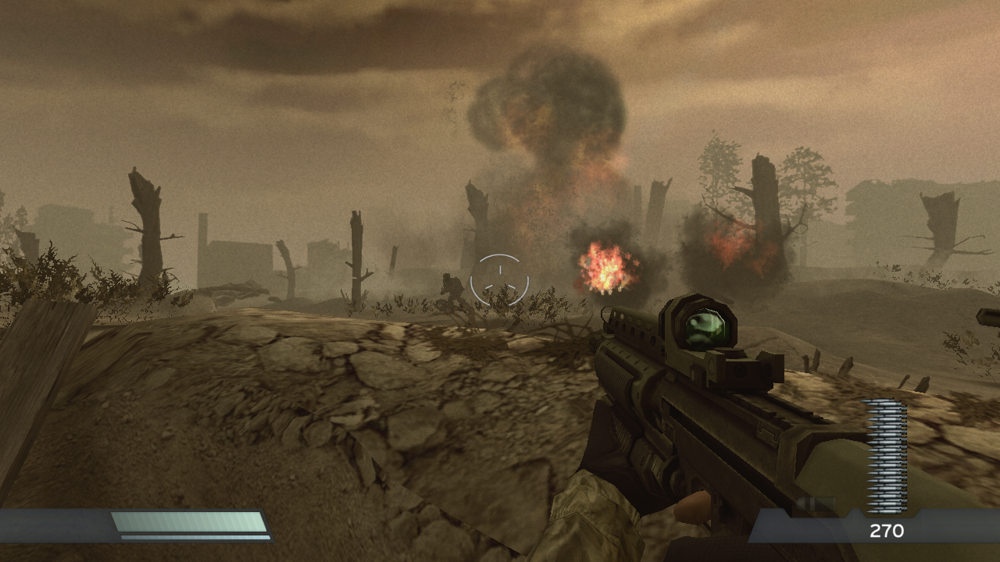
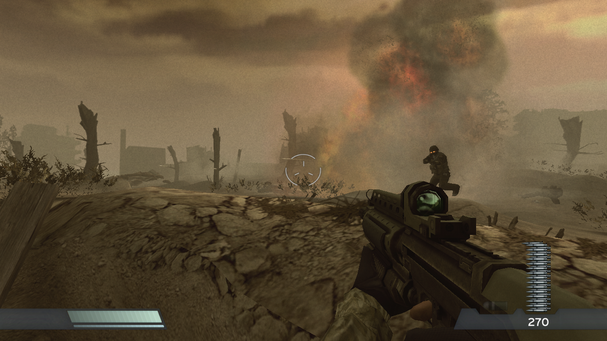
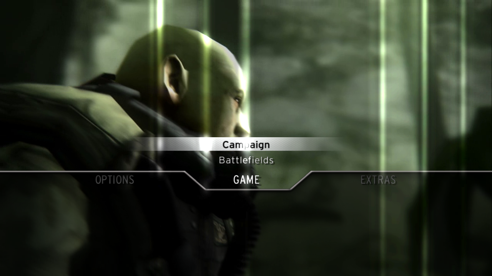
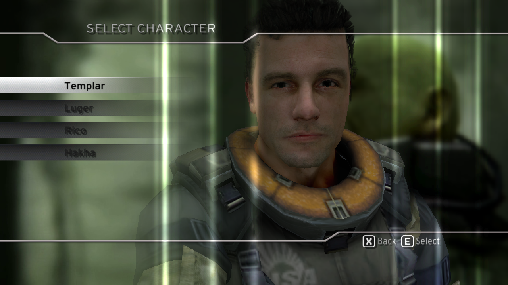

# Screenshots

Captured from the port itself (Linux, RTX 3070 Ti, a headless run at the game's 1280x720 with
`PS3RECOMP_VK_DUMP_MS`), newest first. They show the game running in the port; nothing here is from the PS3.

## 2026-10-30

| | |
|---|---|
|  |  |
| Level 1: the trenches under fire | Level 1: the Helghast advance |
|  |  |
| Main menu, with its background movie | Campaign: character selection |
