# Screenshots

Captured from the port itself on Linux (RTX 3070 Ti), from the developer's own copy of the game, newest first.
The 2026-11-23 set is the frame the port presents to its window (`PS3RECOMP_VK_DUMP_PRESENT`) at 1920x1080, and at
3440x1440 borderless for the 21:9 shot (scaled to 2580x1080 here); the 2026-10-30 set is a headless run at the
game's 1280x720 (`PS3RECOMP_VK_DUMP_MS`). Levels were reached with `KZ_UNLOCK_LEVELS=1` and played with
`KZ_DEBUG_GOD=1` on scripted input. Nothing here is from the PS3.

## 2026-11-23

| | |
|---|---|
| 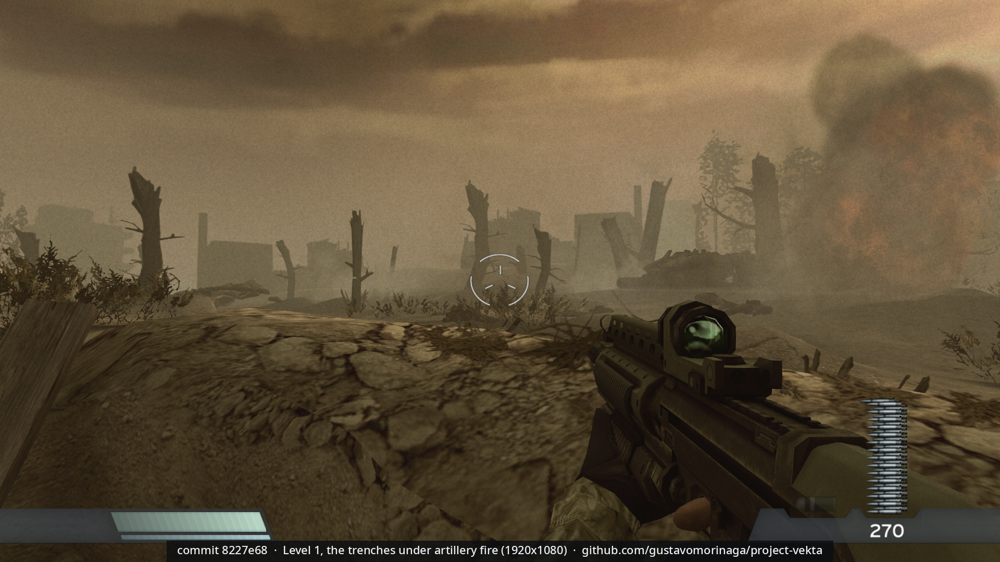 | 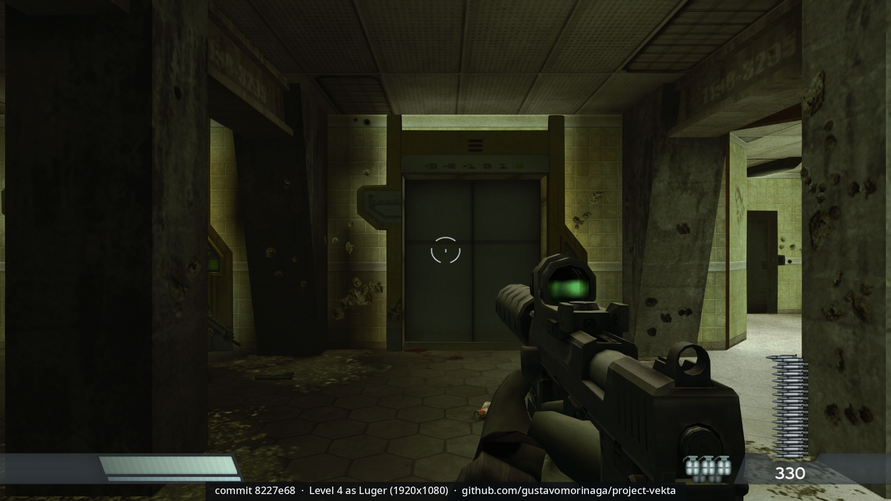 |
| Level 1: the trenches under fire | Level 4 as Luger |
| 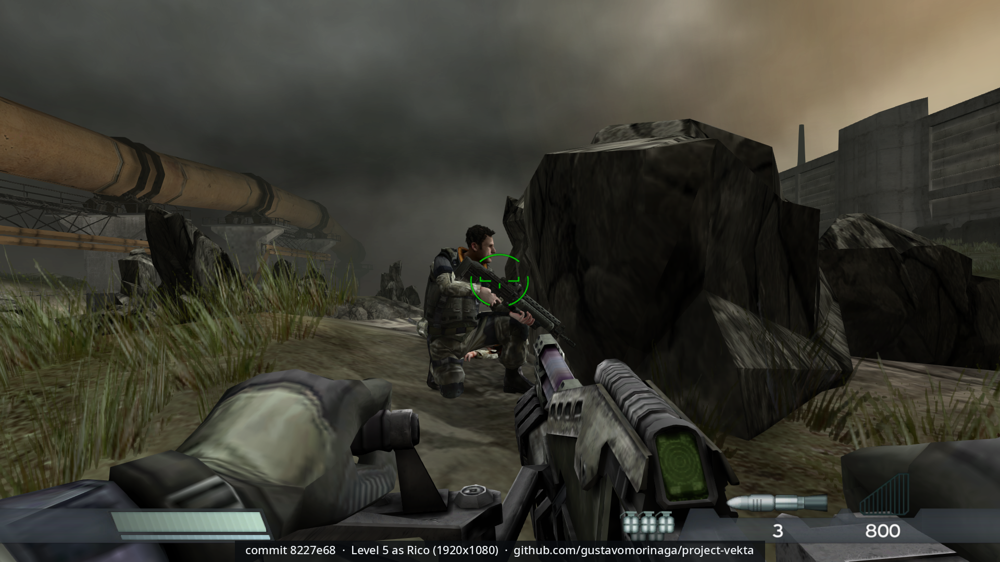 | 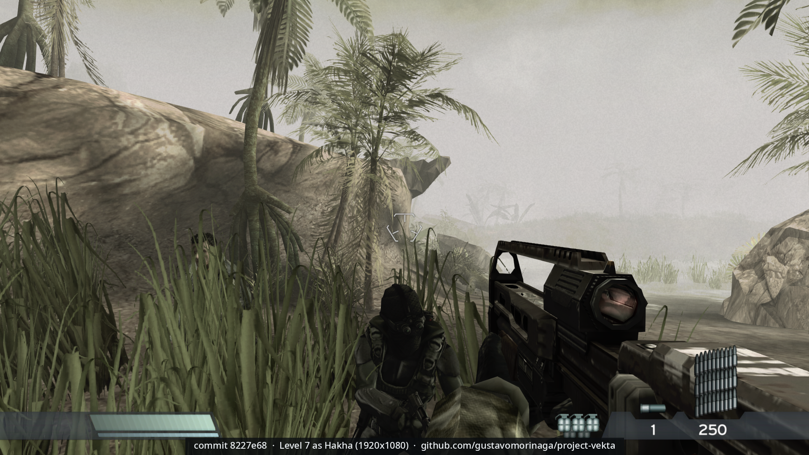 |
| Level 5 as Rico | Level 7 as Hakha |
| 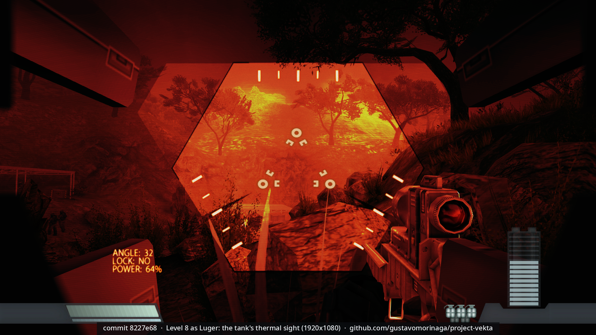 | 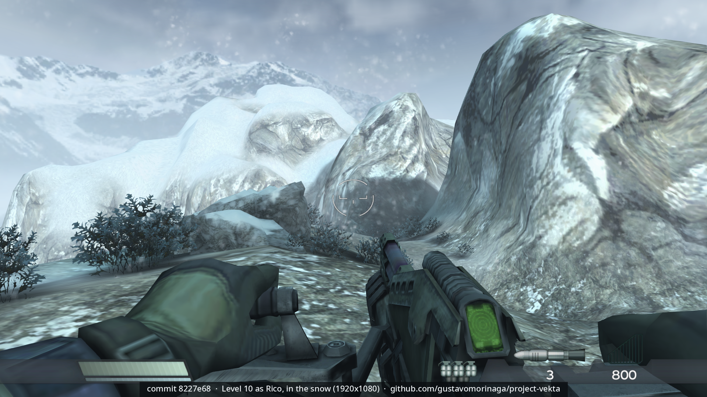 |
| Level 8: the tank's thermal sight | Level 10 as Rico, in the snow |
| 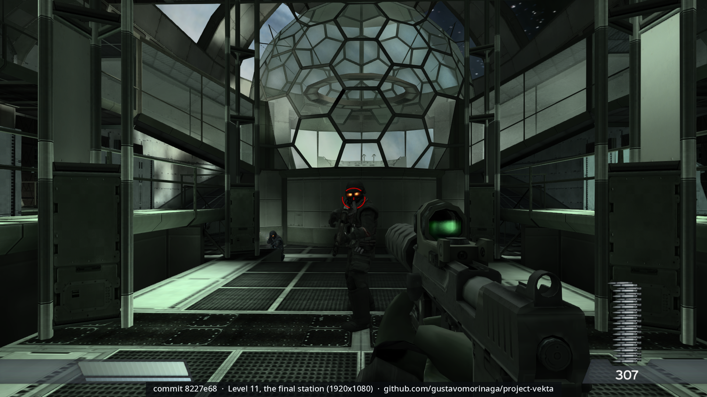 | 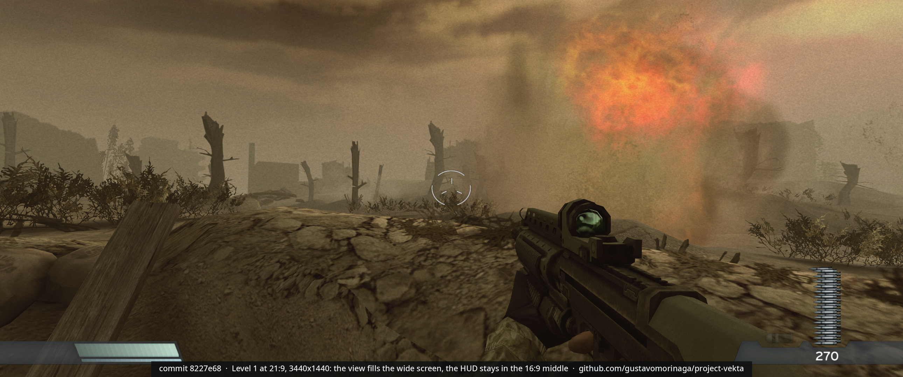 |
| Level 11: the final station | Level 1 at 21:9 (3440x1440) |
| 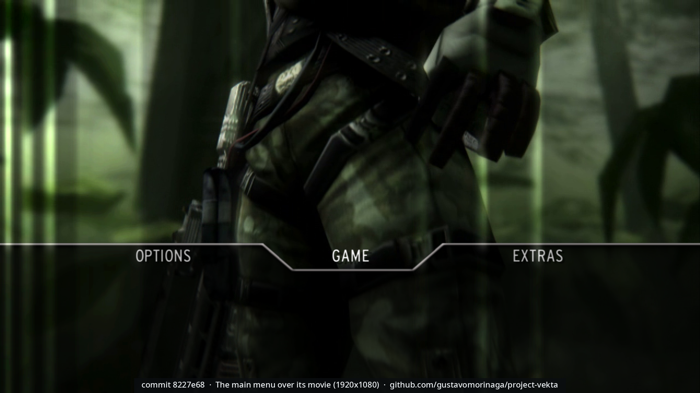 | 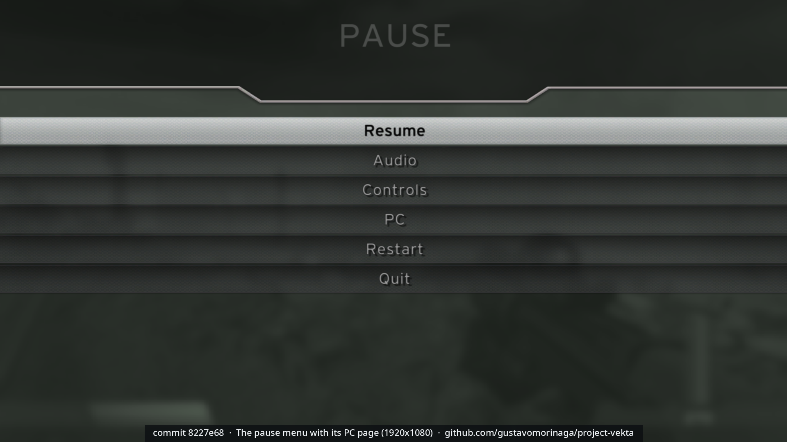 |
| Main menu | Pause menu |
| 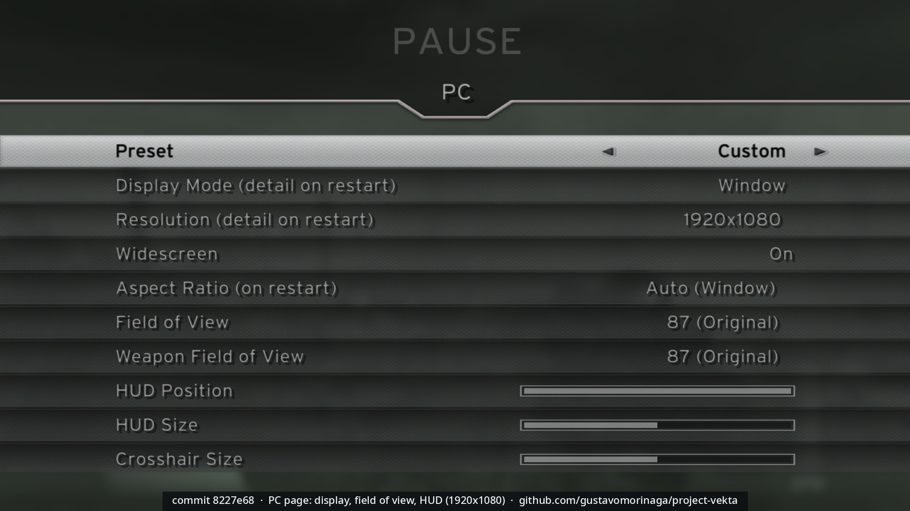 | 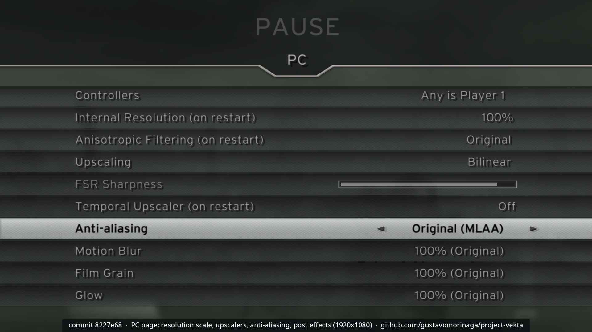 |
| PC page: display and view | PC page: graphics |
| 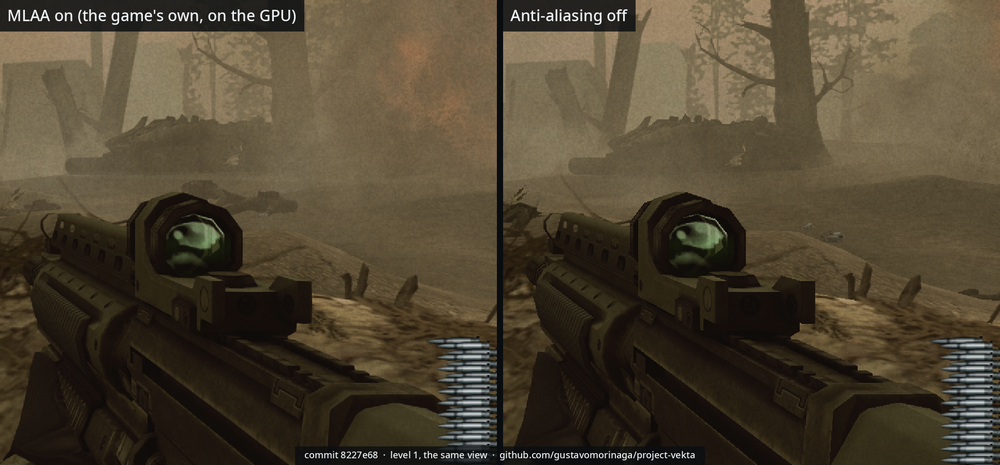 | 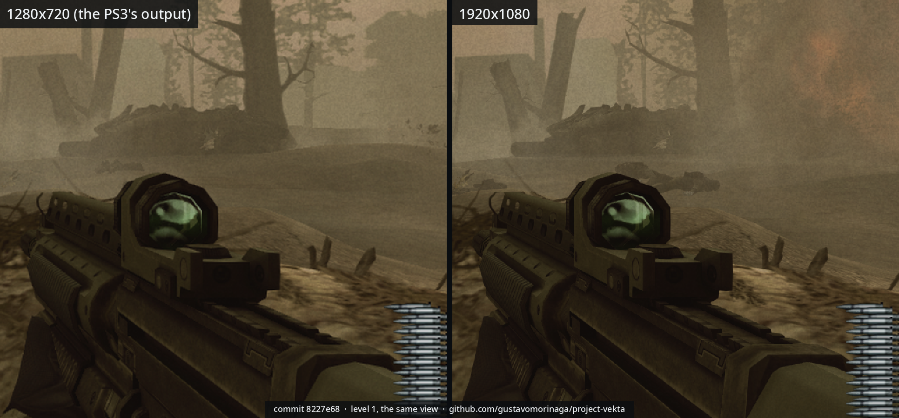 |
| Comparison: the game's MLAA on and off | Comparison: 1280x720 and 1920x1080 |
| 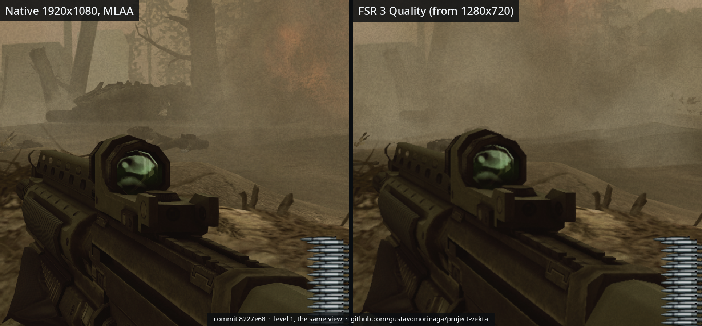 | |
| Comparison: native and FSR 3 Quality | |

## 2026-10-30

| | |
|---|---|
| 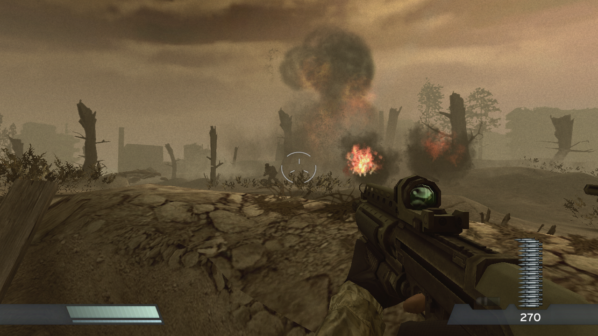 | 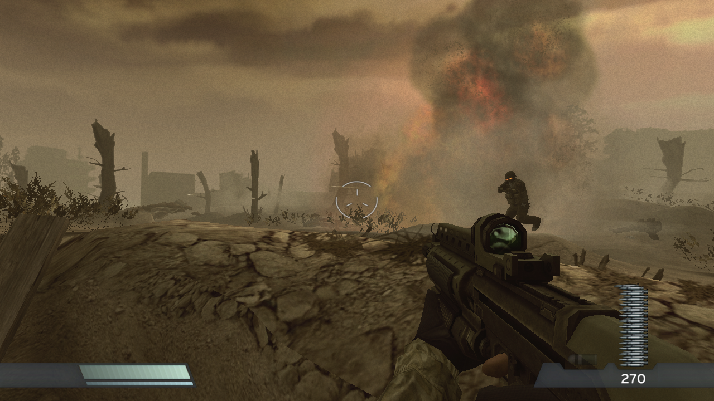 |
| Level 1: the trenches under fire | Level 1: the Helghast advance |
| 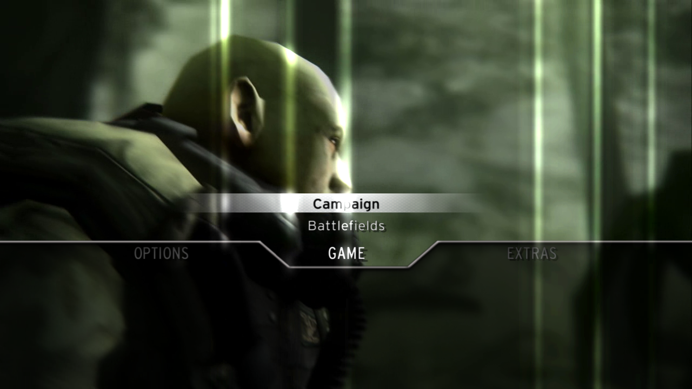 | 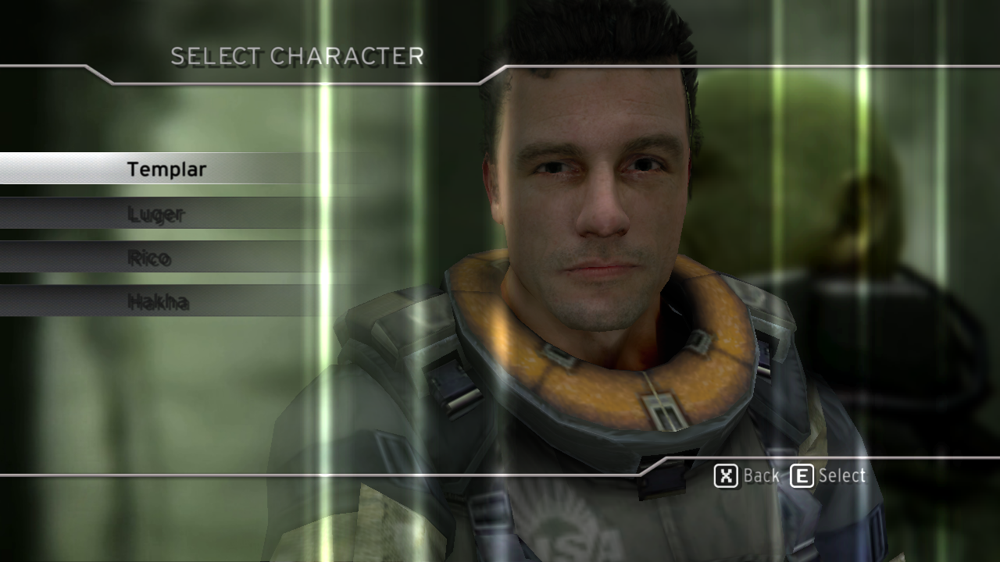 |
| Main menu, with its background movie | Campaign: character selection |
