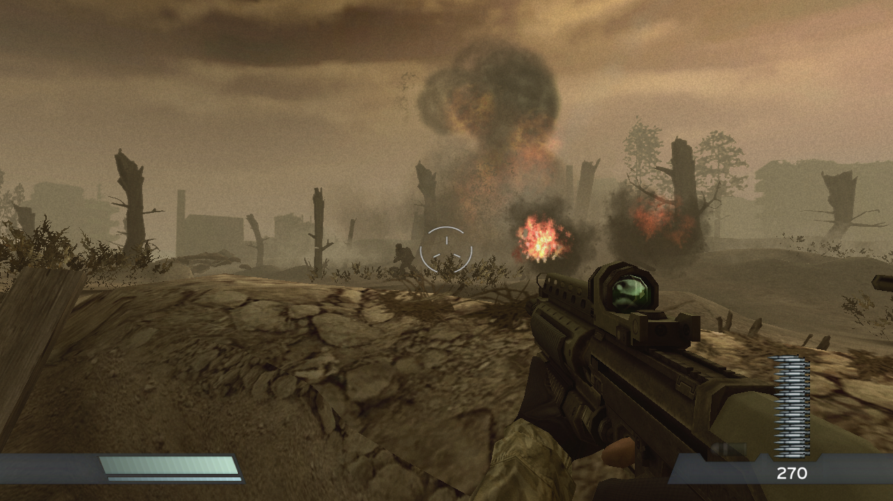

# Status

The full status of the port. The short version is in the [README](../README.md#status).

   
  The port on 2026-10-30: Level 1. More: <a href="SCREENSHOTS.md">screenshots</a>.

As of 2026-11-16, on Linux x64 with an NVIDIA RTX 3070 Ti, the maintainer's machine:

| | |
|---|---|
| Code translation | the whole EBOOT is translated (about 23,400 PPU functions) plus the SPU programs and job modules; this repository's scripts rebuild it byte for byte from the player's files |
| Boot, menus, movies | work: intro movies, front end, options, pause menu, saves and Continue |
| Campaign | the whole campaign, levels 1 to 11, played from start to end on Linux and on Windows (2026-11-16); the levels are not yet each compared with reference footage |
| Frame rate | a steady 60 frames per second by default (the game logic runs at 60 Hz instead of the PS3's 30); an optional 144 Hz mode reaches about 131 to 134 frames per second in Level 1 and Level 7 |
| Sound | stereo, 5.1 and 7.1 output (the game's own mixer fills the extra channels); music decoded with minimp3 in place of the PS3 system software's MP3 decoder |
| Windows | the Windows exe is cross-built on Linux and runs under Wine, Proton and on a real Windows; the whole campaign plays there from start to end (2026-11-16); speed under Wine and Proton is lower (about 100 frames per second in Level 7) |
| Editions | the US edition (NPUA80856, from the Killzone Trilogy disc or the PlayStation Store) and, since 0.8.0, the European one (NPEA00418 from the PlayStation Store, BCES-01743 from the disc), each lifted with its own addresses; the European edition's 11 levels load, and it is not yet played past each level's start (2026-11-25) |
| Multiplayer | Battlefields against bots, and two players on one PC in split screen (since 0.8.0), checked on Linux with scripted input (2026-11-26); not yet played by two people |
| Distribution | you build the port from your own files: on Windows the setup program or folder builds it on your PC (since 0.2.0); on Linux from source, or (since 0.3.0) a Linux folder with its own toolchain (no compiler or packages needed) |

Feature by feature, the PS3 game against the port: [FEATURES.md](FEATURES.md) (generated from the repository's own
records). What is broken or unfinished today: [KNOWN_ISSUES.md](KNOWN_ISSUES.md). Controls, button prompts, display
modes and subtitles: [ACCESSIBILITY.md](ACCESSIBILITY.md).

## PC features

All optional, set in a **PC** page inside the game's own Options and Pause menus and kept in `kz1hd_pc.ini`:

- display mode (window, borderless, fullscreen), output resolution, internal resolution scale, V-Sync (on, off,
  adaptive), VRR, frame-rate limit (30, 60, 120, 144, 165, 240 or Unlimited; 120 and up experimental), NVIDIA Reflex
- AMD FSR 1 upscaling and RCAS sharpening, anisotropic filtering (the game's own or 2x to 16x)
- temporal upscaling on Linux and Windows: AMD FSR 3.1 in every build, and NVIDIA DLSS (Super Resolution and DLAA)
  when you choose to download it at install ([docs/dev/upscalers.md](docs/dev/upscalers.md))
- any aspect ratio (Hor+ for 21:9, 32:9 and wider, the game's own 4:3 view for 4:3 and 16:10, a forced ratio if you
  want one, with the menus and movies kept 16:9), field of view for the world and,
  apart, the first-person weapon (70 to 120 degrees at 16:9), HUD size and position
- presets: Original (PS3), Performance, Balanced, Quality
- keyboard and mouse (direct mouse look, mouse in menus, remappable keys), Xbox, PlayStation, Nintendo and generic
  controllers through SDL, with button prompts that follow the device in use
- two players on one PC in split screen (Game > Battlefields > Two Players): the keyboard and mouse and a
  controller, or two controllers
- stereo, 5.1 or 7.1 sound; game language; skip the opening movie; trophies from the game's own trophy set, kept on
  your PC, with an on-screen notice and a Trophies page

Every option, its default and where it was checked: [FEATURES.md](FEATURES.md).
